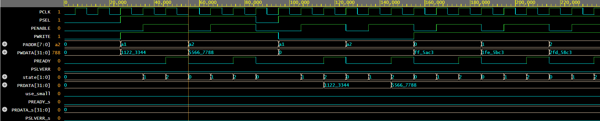
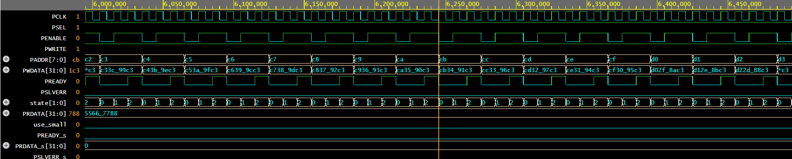
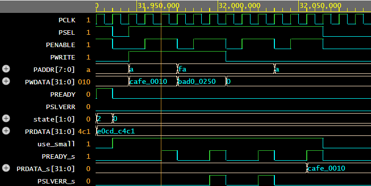

# APB SRAM Slave

A 32-bit APB3 slave with an on-chip SRAM, written in Verilog and verified with a self-checking testbench.

## Features

- APB3 interface: PSEL, PENABLE, PWRITE, PADDR, PWDATA, PRDATA, PREADY, PSLVERR
- 256 x 32-bit memory (parameterised `ADDR_WIDTH`, `DATA_WIDTH`, `MEM_DEPTH`)
- IDLE → SETUP → ACCESS state machine with one wait state per transfer
- PRDATA is valid in the same cycle PREADY is high
- PSLVERR for out-of-range addresses; the memory is not modified on an error

## Files

| File | Description |
|------|-------------|
| `design.sv` | APB SRAM slave |
| `testbench.sv` | Self-checking testbench |

## Verification

The testbench compares every read against a reference model and prints PASS/FAIL at the end.

1. Directed write and read-back (`0xA1`, `0xA2`)
2. Write and read every address (0–255)
3. 500 random reads and writes
4. Error response: second instance with `MEM_DEPTH = 200`, access to address 250 must return PSLVERR

Simulated with Icarus Verilog on EDA Playground.

## Results

### Simulation result

.png)

### Write and read-back

Two writes followed by two reads. PRDATA updates on the same edge PREADY goes high.

### Back-to-back transfers

Consecutive writes with no idle cycles between transfers.

### Error response

Write to address 10 (valid), write and read at address 250 (out of range, PSLVERR high, PRDATA 0), then read-back of address 10.

